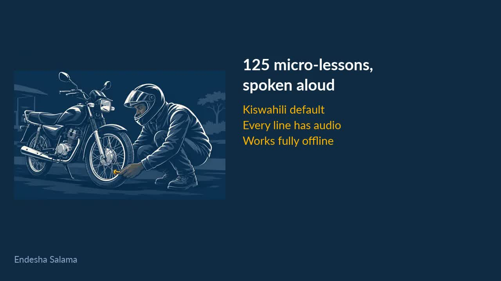
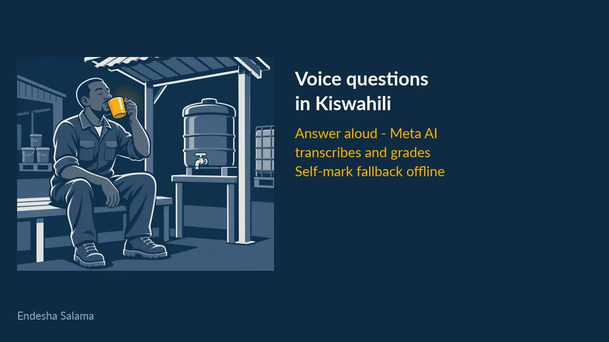

# Endesha Salama

**Live demo (learner app, no login): https://arnoroh.github.io/endesha-salama/** · Built with Muse Code for the Meta Global AI Developer Hackathon — see [SUBMISSION.md](SUBMISSION.md).



 — Usalama wa Pikipiki

Free motorcycle safety lessons in **Kiswahili and English**, built for riders who do not read much.
Each lesson has a picture, short text, a 🔊 button that reads it aloud, and big buttons.
Tests mix Safe or Danger checks with three-choice scenarios. The voice reads all answer options.
The text and pictures work offline after the first visit. Audio for a module downloads when you open
that module in the selected language. Open a module online before using its audio offline.
Both entry pages show one home page for motorcycle and workplace safety. Motorcycle lessons (`index.html?topic=ride`)
collect no personal data and have no accounts. Work lessons (`work.html?topic=fire`, for example) have an optional staff sign-in:
see [HSSE staff platform](#hsse-staff-platform-salama-kazini).

Brought to you by [Masika Ventures](https://masika.ventures).

> **Disclaimer.** This is general safety education. It does not replace formal rider training,
> a valid licence, or the traffic laws of your country. The text and voices were made with the help of
> AI and have **not** been reviewed by a road-safety authority.

## Lessons

The shared home page has nine topics. Motorcycle Safety has the six lessons below. The work topics have
4 Fire and Gas submodules, 4 Lifting and Moving submodules, 5 Protective Gear submodules, 4 Report and Help submodules,
4 Working at Height and Ladders submodules, 4 Electricity and Lockout submodules, 4 Chemicals and Fuels submodules and
4 Heat, Water and Welfare submodules (33 work submodules in total).
Each work submodule uses the existing pictures, text and questions. A work topic is complete only when all its submodules are complete.
Existing whole-topic completions remain valid.

| Module | Topic |
|---|---|
| 🔧 Before You Ride | tyres, brakes, lights, chain, fuel |
| ⛑️ Protective Gear | helmet and strap, vest, gloves, shoes |
| 🛣️ On the Road | speed, gaps, rain and mud, night, overtaking, junctions |
| 🧍 Passengers and Loads | one passenger, passenger helmet, safe loads |
| 🚫 100% Focused | alcohol, phones, tiredness and decisions under pressure |
| 🚑 If a Crash Happens | stay safe, call for help, stop bleeding, arrange careful transport if an ambulance cannot arrive soon |

When a rider finishes everything they can write their name and share a picture certificate with the
phone's own share menu (WhatsApp, etc.). The certificate is drawn on the phone and never uploaded.

## Run it

There is no build step. The website is the `site/` folder.

```sh
npm run serve        # http://localhost:8080
npm run check        # lessons, audio, offline list and size budget (5 MB per 6 modules)
```

### Test on a phone over Tailscale (private)

Offline mode and the share button only work over HTTPS, so plain `http://<tailscale-ip>` is not enough.
`scripts/endesha-salama.service` runs the server on loopback, and Tailscale Serve adds tailnet-only HTTPS.
Install steps are in the header of that file. On the VPS this is live at
`https://inmotion-vps.tail09dd9a.ts.net:4520/`. Never add `--funnel`: that would make it public.
After a lesson edit, reload twice: the offline cache shows the old copy once, then updates.

The current public learning app is `https://inmotion-vps.tail09dd9a.ts.net/endesha-salama/`.
It serves static lessons only. Staff sign-in and reporting need the Worker deployment; the admin preview remains private.

## Change or add a lesson

Everything the learner sees and hears is in `site/lessons.json`:

- `ui` — interface words, per language.
- `modules[].steps[]` — `id`, `pic` (emoji fallback), `art` (picture name), `text` per language.
  A step with `answer` is a question and needs `why` per language. Binary questions use `safe` or `danger`.
  Multiple-choice questions have three `options`, each with an `id` (`a`, `b`, `c`) and `text` per language.
  Their `answer` is the correct option ID. Optional `source` has a `label` and an HTTPS `url`.
  Question audio includes every option. Feedback audio includes the correct option and its explanation.
- Work modules also have `submodules[]`: a stable `id`, a `title` per language and `steps` containing existing step IDs.
  Each work module has 4–6 submodules. They must include every teaching and question step exactly once.

Pictures use the approved comic ink style: off-white lines on navy, with one amber teaching detail.
Each picture is a 480 × 400 WebP in `site/art/`, with a 40 KB limit. `site/art.js` maps its name to
an image. Add each picture to `SHELL` in `site/sw.js` so it is available offline before its lesson
is opened. Keep question pictures free of answer symbols. Source prompts are in
`scripts/art-prompts.json`. Bump `CACHE` after changes to site files.

After a lesson text change, regenerate the voices and check:

```sh
pip install edge-tts imageio-ffmpeg    # imageio-ffmpeg bundles an ffmpeg that can write Opus
export EDGE_TTS=/path/to/edge-tts      # only if edge-tts is not on PATH
export FFMPEG=$(python3 -c 'import imageio_ffmpeg;print(imageio_ffmpeg.get_ffmpeg_exe())')   # or any ffmpeg with libopus
npm run audio                 # only lines that changed are regenerated
npm run check
```

**Sound size.** Clips are Ogg Opus, 16 kbps mono: about 0.55 MB per language, so a first visit is about
0.7 MB (the same clips as 48 kbps MP3 were 2 MB). Opus plays on Android, Chrome and Firefox. Older iPhones
and Safari versions may not play it (not tested); if that matters, switch `scripts/make-audio.mjs` to
`libmp3lame` at 24 kbps and the `.ogg` names in `site/content.js` and `scripts/serve.mjs` to `.mp3`.
Changing the bitrate there and re-running `npm run audio` after deleting `site/audio/*/` re-encodes everything.

### Add a language

1. Add it to `langs` and `voices` in `lessons.json` (list voices with `edge-tts --list-voices`).
2. Add every `ui` string and every step `text` / `why` in that language.
3. `npm run audio && npm run check`. The check tells you what is missing.

## HSSE staff platform (Salama Kazini)

The same app also teaches workplace safety to Masika Ventures staff. Eight modules (72 steps, Kiswahili and English)
have `"track": "work"` in `lessons.json`: Fire and Gas, Lifting and Moving, Protective Gear at Work, Report and Help,
Working at Height and Ladders, Electricity and Lockout, Chemicals and Fuels, and Heat, Water and Welfare. The last four were
added as the standard HSSE items not covered by the first four; their pictures were generated from `scripts/art-prompts.json`
to the same 480x400 WebP standard. No HSSE professional has reviewed the new modules yet.
Both entry pages show the shared topic list. Motorcycle lessons open in `index.html?topic=ride`; a work topic opens in
`work.html?topic=MODULE_ID`. The lesson screens and certificates keep the two tracks separate.
The rider certificate does not need the work modules. Work submodule progress is saved on the phone; the existing parent
module ID is sent to the staff API only after all its submodules are complete. Staff progress is separate for each code and refresh deadline.

| Part | Where | What it does |
|---|---|---|
| Staff app | `site/work.html` | Same screens and voices. A personal code (or link `work.html?c=CODE`) signs the phone in. Finished modules are queued on the phone and sent when online. |
| Staff API | `server/index.mjs` (Cloudflare Worker) | `GET /api/me`, `POST /api/complete`. The code in the `X-Staff-Code` header is the only credential. 120 calls per minute per client IP. |
| ERP/HRM API | `/api/v1/*` (`docs/API.md`, `server/openapi.json`) | Versioned REST for Odoo, ERPNext, SAP or any HRM: employees, assignments, completions, status, with API keys (read/write/admin scopes) and signed webhooks (`completion.created`, `assignment.created`). |
| Admin portal | `/admin` (`server/admin.html`) | Individual accounts with roles — HR (people, links), HSSE (assignments, due/overdue, reports), Admin (all, plus API keys, webhooks, users, audit log). `ADMIN_TOKEN` remains as bootstrap admin. Portal is in English; the learner app is Kiswahili-first. |
| Database | Cloudflare D1 (SQLite), `migrations/` | `employee` (Odoo or generic ERP link, `country`, `language`), `assignment`, `completion`, `admin_user`/`admin_session`, `api_key`, `webhook`/`webhook_delivery`, `audit_log`, view `assignment_status`. Add a schema change as a new numbered file in `migrations/`. |

**Open source, one organisation per deployment.** Anyone can run their own copy (own Cloudflare account, own D1 database, own `ADMIN_TOKEN`). One deployment serves one organisation; run separate deployments for separate organisations. `country` defaults to `TZ` and `language` to `sw` (Kiswahili first). East African country codes `TZ KE UG RW BI SS CD SO` are the supported focus; lesson emergency numbers and legal references are still Tanzania-specific and need a local review per country before use there.

**ERP/HRM link.** Every employee row needs one identity: `odoo_login`, `odoo_employee_id`, or `external_system` + `external_id` from any other ERP/HRM, plus the person's name.
In the admin portal paste a CSV export (Odoo headers such as "Employee Name", "Related User/Login", "ID", "Work Email" are recognised, as are generic `external_system`/`external_id`, `country` and `language` columns).
Importing again updates people by that identity and never creates a second record or a new code. There is no live Odoo sync yet; ERPs connect through `/api/v1` (see `docs/API.md`). Production Odoo at Masika Ventures is read-only by default
(see `MV_odoo_infra/AGENTS.md`), so add a sync only through that approved workflow.

**Refresher schedule.** Rider refresher assignments repeat every 3 months, work HSSE assignments every 6 months (per-assignment `refresh_months`, HSSE can change it). Rider modules open with a hook line and unlock in sequence. Employees may optionally sign in on the rider app with their code to save completions and quiz answers for HSSE; anonymous riders are never tracked, and name/employee ID/department/company on the certificate are optional and stay on the phone unless signed in. Rollout (Teams, email, supervisors, onboarding, monthly scenarios, reminders, six-month HSSE review) is in `docs/ROLLOUT.md`.

**Six-month refresh.** Each work assignment has `refresh_months` (default 6; rider refresher 3). After a person finishes a module the next due date is that date plus the interval.
Status: `pending` (never done, before the deadline), `overdue`, `due_soon` (within 30 days) or `current`. A later completion restarts the interval. There are no reminder messages yet.

**Personal codes.** An 8-character code is made when a person is added. Only its SHA-256 hash is stored. The code and link are shown once in the admin portal
(CSV download of links available). "New link" replaces the code and the old one stops working at once. Send each person only their own link.

**Run it locally.** The whole platform is one Cloudflare Worker (`wrangler.jsonc`): `site/` as static files, `/api` and `/admin` in
`server/index.mjs`, data in D1. `wrangler dev` runs the same code on this machine with a local D1 database.

```sh
npm run server               # wrangler dev on http://localhost:8787; ADMIN_TOKEN from .dev.vars or --env-file
npm run test:server          # real Worker in wrangler dev, throwaway local D1
scripts/hsse-server.service  # tailnet preview: wrangler dev on 127.0.0.1:4521, data in ~/.local/share/hsse-d1
tailscale serve --bg --https=4521 http://127.0.0.1:4521      # tailnet only; never --funnel
```

The secret `ADMIN_TOKEN` is in `~/.config/endesha-salama/env`, not in the repository.
Preview: `https://inmotion-vps.tail09dd9a.ts.net:4521/work.html` and `/admin`.

**Before staff use it for real.**
- The admin portal lists employee records. Put `/admin` behind Cloudflare Access before the Worker gets a public hostname (see below).
- The staff app stores a name and training results for an employer. Tell staff (the app says so on the sign-in box) and keep Tanzanian data-protection duties in mind.
- No HSSE professional has reviewed the work lessons. Their text is based on Masika HSSE evidence (below) and general practice, and the Kiswahili needs a native check.
- The work pictures are painted from the prompts in `scripts/art-prompts.json`, in the same comic ink style as the rider pictures.

## Put it online (Cloudflare Workers + D1)

One Worker serves the rider app (`/`), the staff app (`/work.html`), the staff API and the admin portal. Requests for
files in `site/` are static assets and do not run the Worker. Only Arno can approve a public deploy.

First time:

```sh
npx wrangler login
npx wrangler d1 create hsse            # copy the database_id it prints into wrangler.jsonc
npx wrangler secret put ADMIN_TOKEN    # 24+ random characters, e.g. openssl rand -hex 24
npm run deploy                         # check, test, apply D1 migrations, deploy
```

Then, before anyone uses it:

1. Add a custom domain to the Worker (dashboard → the Worker → **Settings** → **Domains & Routes**).
2. Zero Trust → **Access** → **Applications** → **Self-hosted**: the same hostname, path `admin`, allow only named emails.
   Check that `curl https://<host>/admin/api/overview` returns the Access login redirect, not `{"error":"admin token required"}`.
3. Turn off the `workers.dev` address of the Worker, or put it behind Access too, so `/admin` has no unprotected address.

Later deploys: `npm run deploy`. A schema change is a new file in `migrations/`, applied by the same command.
The Cloudflare dashboard changes now and then; if a menu differs, the settings above are what matters.

## Content evidence and review status

- 2026-10-09: the four work modules were chosen from Masika HSSE records: the TML monthly HSSE meeting of 2026-08-24 (incidents, hazards, PPE use, noise,
  gas cylinders, first aid box, no near misses reported) and the SES expert report of 2026-09-18 (safety shoes, goggles, gas cylinders, escape routes, ladders,
  manual unloading, steam, training). Lessons are general and name no person or site. No HSSE professional has reviewed them.
  The Teams team and channel list could not be read (missing `Team.ReadBasic.All` consent), so channel context came from message and SharePoint search only.

- 2026-10-02: Joyce's feedback led to 18 multiple-choice questions and six binary checks, four per module.
  Short explanations remain. The focus module has a new title. The crash module explains how to seek
  suitable transport if an ambulance cannot arrive soon, with precautions for head and neck injuries.
  These changes have not had a human road-safety or first-aid expert review.
- Tanzania motorcycle figures: [NBS and Tanzania Police, January–December 2025](https://www.nbs.go.tz/uploads/statistics/documents/en-1774441493-CRIME%20STATISTICS%20REPORT%20ENGLISH%202025.pdf#page=58),
  Table 3.5, printed page 48: 287 deaths and 311 injuries in reported motorcycle crashes.
  These are police records for Tanzania, including Zanzibar. They are not a complete burden estimate
  or a risk per trip. The lesson does not calculate a fatality rate from reported crash counts.
- Wider road risk: [WHO Tanzania country profile, 2023](https://www.who.int/publications/m/item/road-safety-tza-2023-country-profile)
  estimates 10,052 road traffic deaths for 2021 (95% confidence interval: 8,246–11,858).
  This covers all road users. It is not a motorcycle-only count or a current-year figure.
  Neither source compares risks across Masika Ventures activities.
- Visor and helmet advice: [NSW Motorcycle Rider Handbook](https://www.nsw.gov.au/sites/default/files/2021-05/motorcycle-riders-handbook.pdf),
  the helmet and eye protection sections. Use clear eye protection at night. Replace a helmet hit in
  a crash. No fixed percentage is claimed for the effect of a tinted visor on night vision.
- Crash response: [WHO Community First Aid Response pocket guide](https://cdn.who.int/media/docs/default-source/integrated-health-services-(ihs)/csy/cfar-pocketguide.pdf),
  trauma and bleeding sections, and [Red Cross head, neck and spinal injury guidance](https://www.redcross.org/take-a-class/resources/learn-first-aid/head-neck-spinal-injury).
  First aid and timely transport must account for possible spinal injury. Seek trained help; do not lift
  casualties hastily. This app does not teach practical casualty movement or CPR skills.

- 2026-10-01: a second AI (OpenAI GPT-6.1-Sol, via Codex) reviewed all lessons for road-safety accuracy,
  Kiswahili and English wording, and how the lines sound read aloud. No answer key was wrong. Its must-fix
  items (crash advice, emergency number, disclaimer) and most should-fix items are applied.
- **No human road-safety or first-aid expert has reviewed this.** Please do so before promoting it widely,
  and send corrections as issues or pull requests.
- Tanzania emergency numbers: [TCRA's numbering notice published by ITU](https://www.ituob.org/issues/1248-en/)
  assigns 115 to ambulance services and 112 to police. The lesson says to try these numbers; it does not
  promise ambulance availability. [The Ministry of Health](https://moh.go.tz/en/news-single/huduma-za-dharura-zimeimarika-nchini-dkt-sylvanus)
  says national ambulance coordination and integration with 115 are still being completed.
  Elsewhere, use the local emergency number. No number is confirmed here for eastern DRC.
  Spoken digits have spaces (`1 1 5`) so the voice reads them separately.

## Privacy and retention

See `docs/PRIVACY.md`: what is stored, self-reported record integrity,
retention (sessions, delivery receipts), employee erasure in /admin, and the
owner decision required before reminder email sends staff names to a mail relay.

## Licences

- **Code** (`site/*.js`, `site/*.html`, `site/*.css`, `scripts/`): [MIT](LICENSE).
- **Content** (lessons, text, pictures, icons, certificate design): [CC BY 4.0](LICENSE-CONTENT).
  Credit "Masika Ventures — Endesha Salama" and link to this repository.
- **Font** (`site/fonts/overpass.woff2`): [Overpass](https://github.com/RedHatOfficial/Overpass), SIL Open Font
  License 1.1. It descends from Highway Gothic, the road-sign lettering, and is self-hosted so it works offline.
- **Audio** (`site/audio/`): machine-generated with Microsoft neural voices through the
  [edge-tts](https://github.com/rany2/edge-tts) tool. These are placeholders. Microsoft's terms for
  redistributing this audio are not clear, so do not rely on it for commercial reuse. Replace it with human
  recordings or a licensed speech service (e.g. Azure Speech) before wider reuse, then re-run `npm run check`.
